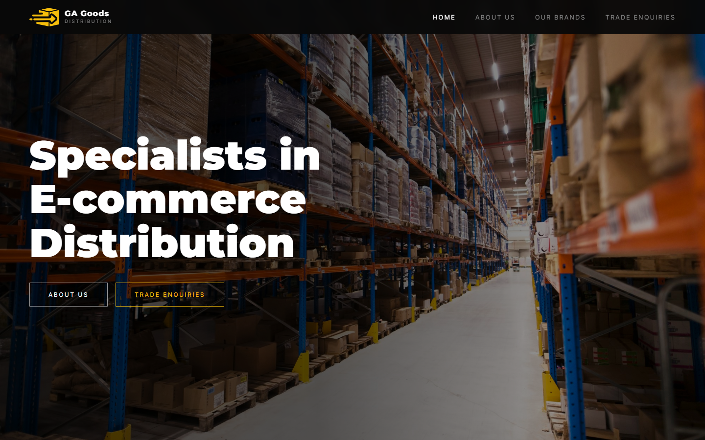
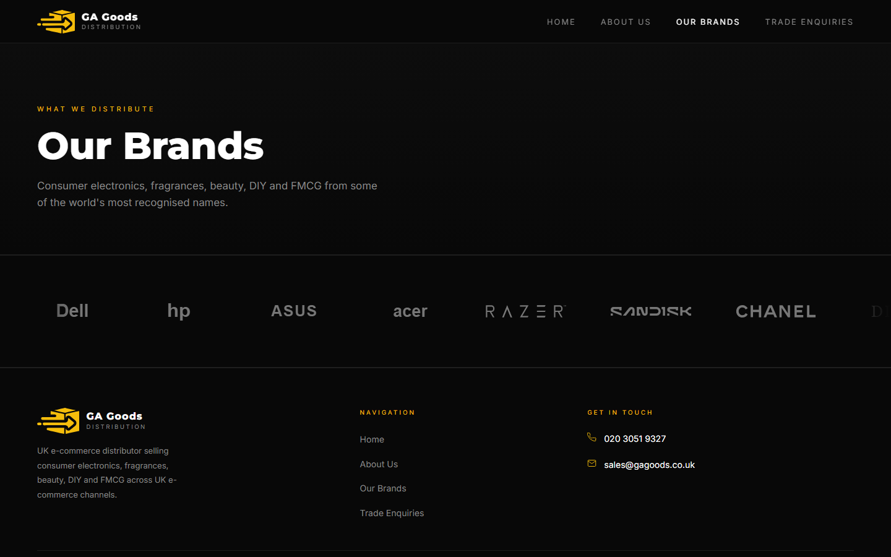
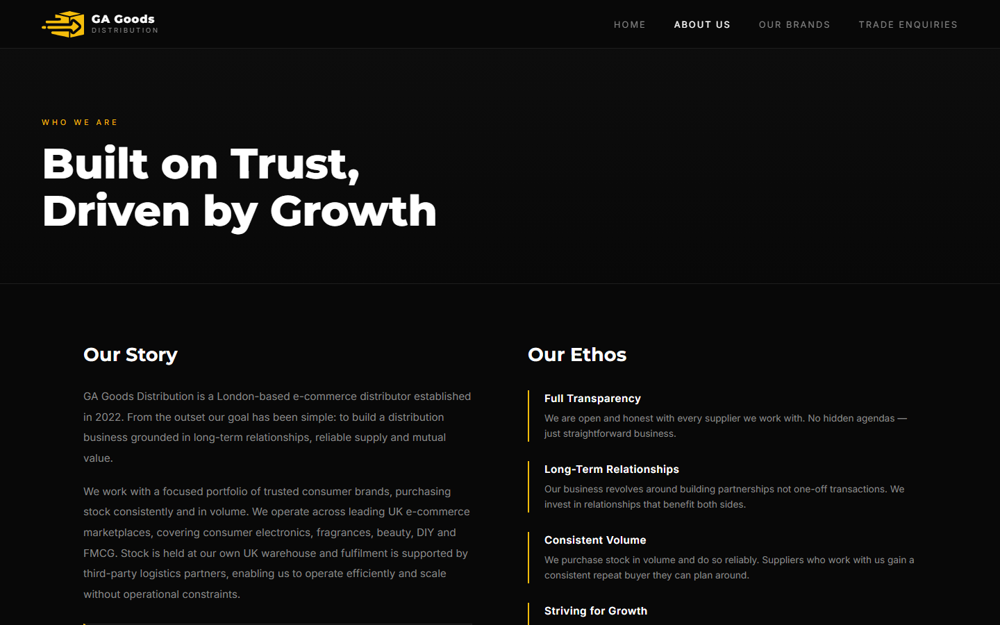
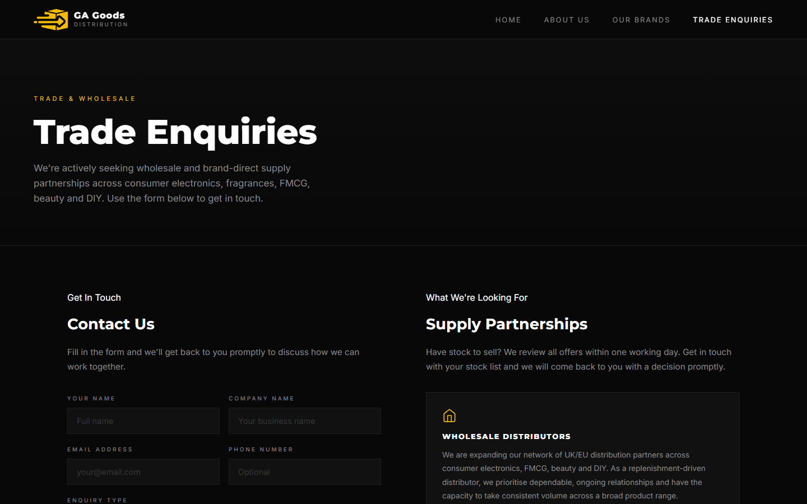
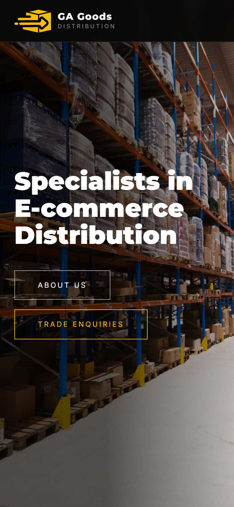

# GA Goods Distribution website

Static, multi-page business website for GA Goods Distribution, a UK e-commerce distribution business.

**Live site:** https://gagoods.co.uk

## What the site is for

GA Goods Distribution (a trading name of Get Ahead Limited) sells branded consumer goods across UK e-commerce channels. The website acts as a proof-of-business presence when opening trade accounts with manufacturers, brands and wholesale distributors: it explains who the business is, which categories and brands it works with and gives suppliers a simple way to send a trade enquiry.

## Features

- **Pages:** Home, About Us, Our Brands, Trade Enquiries, Contact, a form thank-you page and a branded 404 page
- **Trade enquiry form** handled by Netlify Forms, with a honeypot field for spam protection and a redirect to a custom thank-you page
- **Animated brand ticker:** a CSS-only infinite scrolling strip of brand logos (SVG), duplicated for a seamless loop
- **Responsive layout:** mobile-first adjustments at 900px, 560px and 480px breakpoints, plus a hamburger navigation menu on small screens
- **SEO:**
  - Unique `<title>` and meta description on every page
  - Open Graph tags and a canonical URL on the home page
  - Organization structured data (JSON-LD) on the home page
  - `sitemap.xml` and `robots.txt` (thank-you and 404 pages excluded and marked `noindex`)
- **Favicon set:** SVG favicon (`icon.svg`) plus a PNG Apple touch icon (`favicon.png`)
- **Lightweight:** no framework, no build step and no runtime dependencies beyond Google Fonts; vector logos keep the page weight low

## Tech stack

- HTML5
- CSS3 (custom properties, Flexbox, Grid, keyframe animations)
- A few lines of vanilla JavaScript for the mobile menu
- Google Fonts (Inter and Montserrat)
- Netlify (hosting and Forms)

## Deployment

The site is deployed to [Netlify](https://www.netlify.com/) as a static site with no build command; the publish directory is the repository root. Netlify detects the `data-netlify="true"` attribute on the trade enquiry form at deploy time and stores submissions in the Netlify dashboard, where email notifications are configured.

## Local preview

No build step is needed.

1. Clone the repository:
   ```bash
   git clone <repository-url>
   cd gagoods-website
   ```
2. Serve the folder with any static server, for example:
   ```bash
   python -m http.server 8000
   ```
   or
   ```bash
   npx serve .
   ```
3. Open http://localhost:8000 in your browser.

Form submissions only work once deployed to Netlify (or when running `netlify dev` with the Netlify CLI).

## Project structure

```
gagoods-website/
├── index.html        # Home: hero, brand ticker, company overview and stats
├── about.html        # Company story and ethos
├── brands.html       # Brands we distribute (scrolling ticker)
├── trade.html        # Trade enquiry form (Netlify Forms) and supply partnerships
├── contact.html      # Contact details and partnership benefits
├── thankyou.html     # Form success page (noindex)
├── 404.html          # Branded not-found page (noindex)
├── styles.css        # All site styles, including responsive breakpoints
├── icon.svg          # Logo icon / SVG favicon
├── favicon.png       # Apple touch icon
├── background.jpg    # Hero background image
├── brands/           # Brand logos (SVG) used in the ticker
├── robots.txt
├── sitemap.xml
├── docs/
│   └── screenshots/  # README screenshots
├── LICENSE
└── README.md
```

## Screenshots

| Home | Our brands |
|---|---|
|  |  |
| **About us** | **Trade enquiries** |
|  |  |

<p align="center"></p>

## Licence

The code is released under the [MIT Licence](LICENSE). The GA Goods name, logo and site copy are not covered by the licence; third-party brand logos belong to their respective owners.
